# AirSpace

**Live demo:** https://nfl-big-data-bowl-hackathon.vercel.app

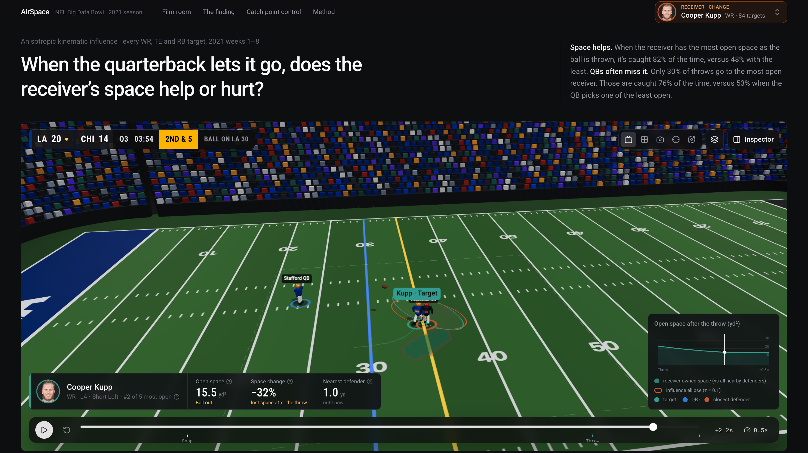

## The question

> **When the quarterback lets go of the ball, does the receiver's space help or hurt?**

"Open" is usually one number: the distance to the nearest defender. But two receivers can both be two yards from their defender and still be in very different spots. One owns the place where the ball will come down. The other does not.

## Abstract

We looked at every pass to a wide receiver, tight end or running back in 122 NFL games (2021, weeks 1 to 8): **7,104 targets**. Each player becomes a moving, direction-aware zone of influence. A receiver's **open space** is the area he owns, in square yards, when the ball is thrown.

**What we found**

| | Finding | Key number |
|---|---|---|
| 1 | More open space at the throw means more catches | **82%** caught with the most space, **48%** with the least |
| 2 | Quarterbacks often skip the most open receiver | only **30%** of throws go to him; those are caught **76%** of the time |
| 3 | Space gained after the throw does not help | **65%** vs **61%** caught |
| 4 | Distance alone hides who owns the landing spot | at 1 to 2 yards apart: **34%** vs **67%** caught |
| 5 | Catches are won in the second before the throw | control at the throw: **0.75** caught vs **0.62** not caught |

*In every chart below, teal is good for the offense, orange is good for the defense, and grey is the league average.*

---

## The story

### 1. More open space at the throw means more catches

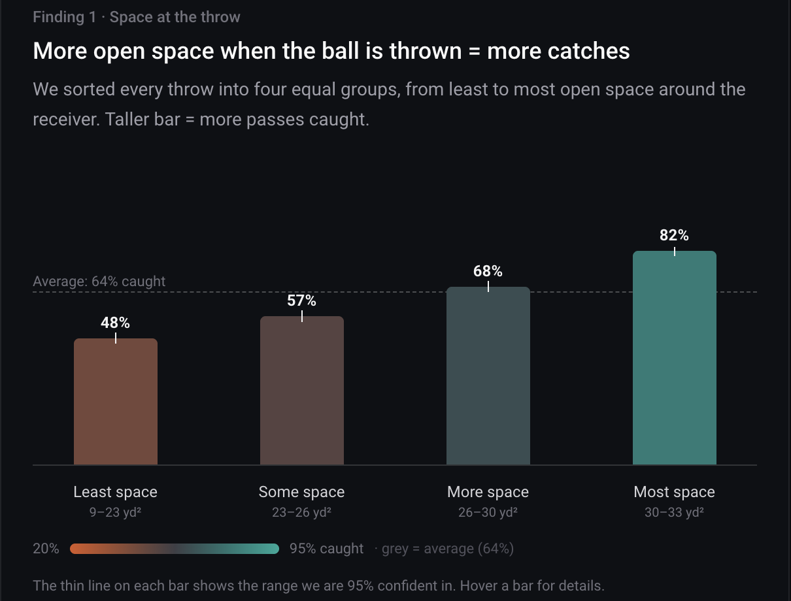

Every throw is sorted into four equal groups, from least to most open space.

- The catch rate climbs at every step: **48% → 57% → 68% → 82%**.
- Open receivers also gain more: 9.4 yards per target in the most-open group against 5.3 in the least-open group.

### 2. Quarterbacks often skip the most open receiver

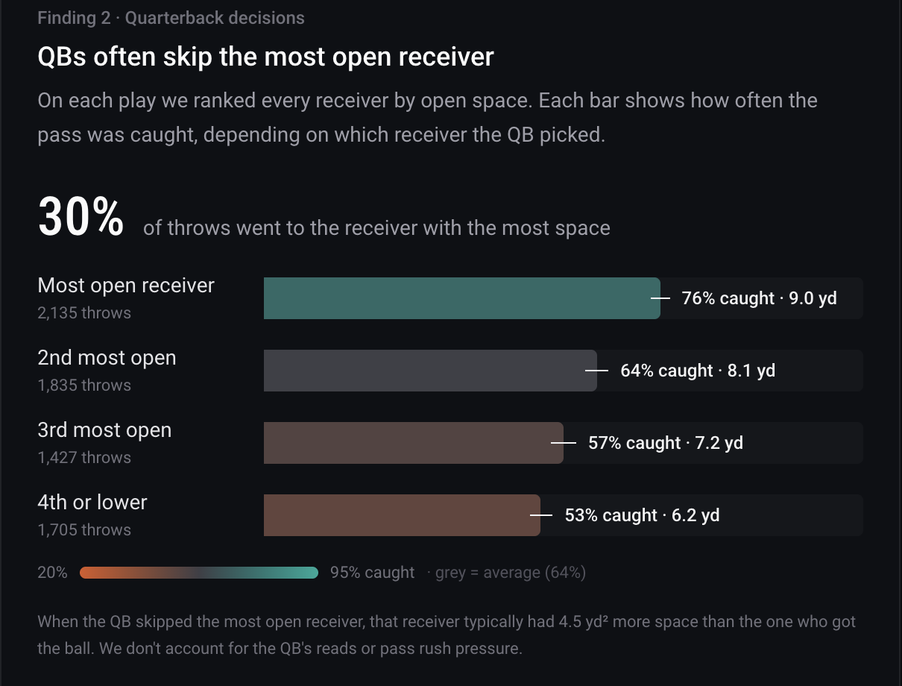

On each play, every route runner is ranked by open space. The bars show how often the pass was caught, depending on who the quarterback picked.

- Only **30%** of throws went to the most open receiver.
- Those throws were caught **76%** of the time. Throws to the 4th option or lower were caught **53%** of the time.
- When the quarterback passed on the open man, that receiver had about **4.5 yd²** more space than the one who got the ball.

We don't see the quarterback's reads or the pass rush, so some of these choices were right for reasons the data can't show.

### 3. Space that opens after the throw barely helps

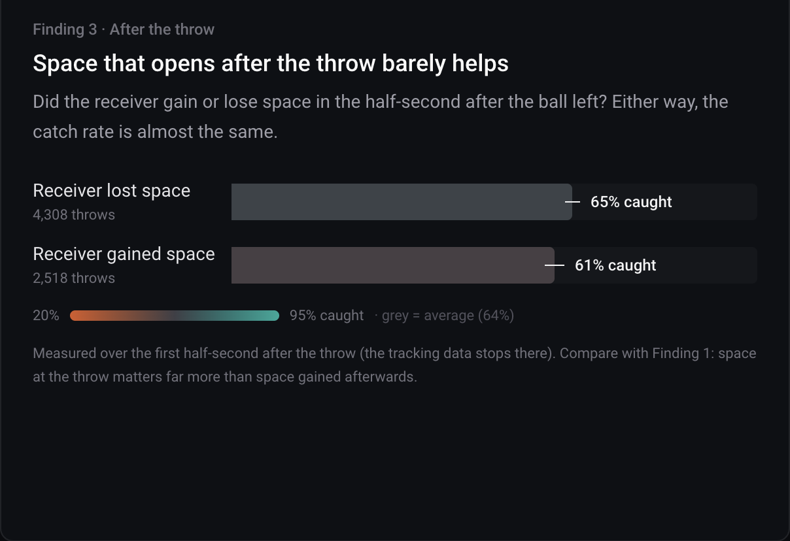

We compared each receiver's space at the throw with his space half a second later, the last moment the tracking covers.

- Receivers who **lost** space: **65%** caught (4,308 throws).
- Receivers who **gained** space: **61%** caught (2,518 throws).

What matters is the space a receiver has when the ball leaves the quarterback's hand.

### 4. How good is open space as a measure?

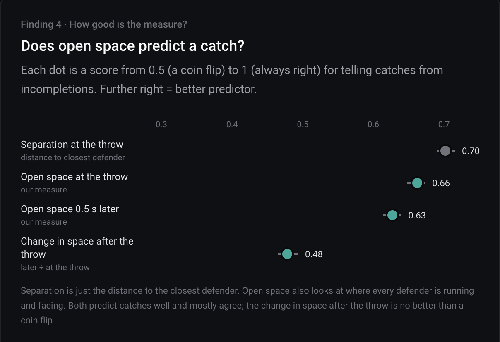

Each dot scores how well a measure tells catches from incompletions: 0.5 is a coin flip, 1.0 is perfect.

| Measure | Score |
|---|---|
| Separation at the throw (distance to closest defender) | **0.70** |
| Open space at the throw | **0.66** |
| Open space 0.5 s later | 0.63 |
| Change in space after the throw | 0.48 (coin flip) |

Separation is slightly better on its own, and the two mostly agree. We keep open space because it is the only one of the two that can rank **every** receiver on a play at once. That ranking is what makes finding 2 possible.

### 5. Who gets the space

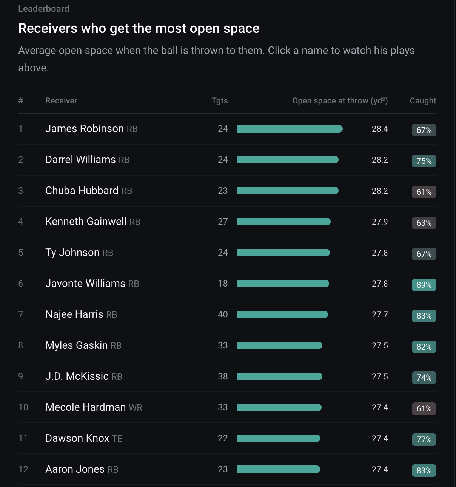

Average open space at the throw for receivers with at least 15 targets (175 players), adjusted so small samples don't top the list.

- Running backs fill **17 of the top 20** spots. They are often the safety valve, so compare players within a position.
- The typical player has 27 targets, so read this as "worth a look", not a final ranking.

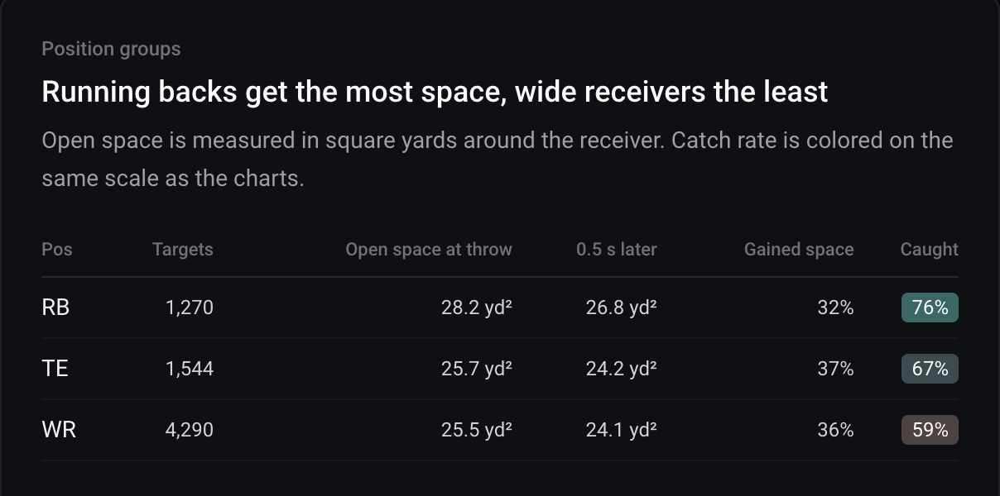

| Position | Targets | Open space at throw | Caught |
|---|---|---|---|
| RB | 1,270 | 28.2 yd² | **76%** |
| TE | 1,544 | 25.7 yd² | 67% |
| WR | 4,290 | 25.5 yd² | 59% |

Tight ends and wide receivers get almost the same space but differ by 8 points in catch rate. Space explains a lot, but not everything.

---

## Deep dive: separation is a distance, control is a field

Open space asks how much room a receiver has. The deep dive asks a sharper question: **when the ball is thrown, who owns the spot where it will come down?**

We call this **control of the landing spot**: 0.5 is a toss-up, 1.0 means the receiver owns it. Tracking ends half a second after the throw, so we estimate the landing spot from the ball's direction and the receiver's path. This works for 6,790 targets.

### 6. Same separation, very different odds

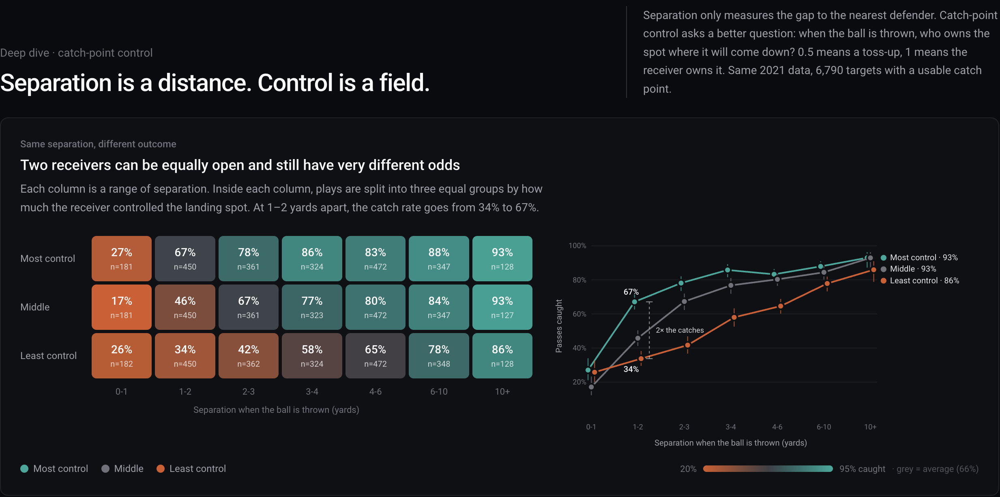

Each column is a range of separation. Inside each column, plays are split into three equal groups by control.

| Separation | Least control | Most control |
|---|---|---|
| 1 to 2 yd | **34%** | **67%** |
| 2 to 3 yd | 42% | 78% |
| 3 to 4 yd | 58% | 86% |

At the same distance, the receiver who controls the landing spot is caught **about twice as often**. Control matters most at 1 to 4 yards. Below 1 yard almost every pass fails, and beyond 10 yards almost every pass is caught.

### 7. Control is not just distance

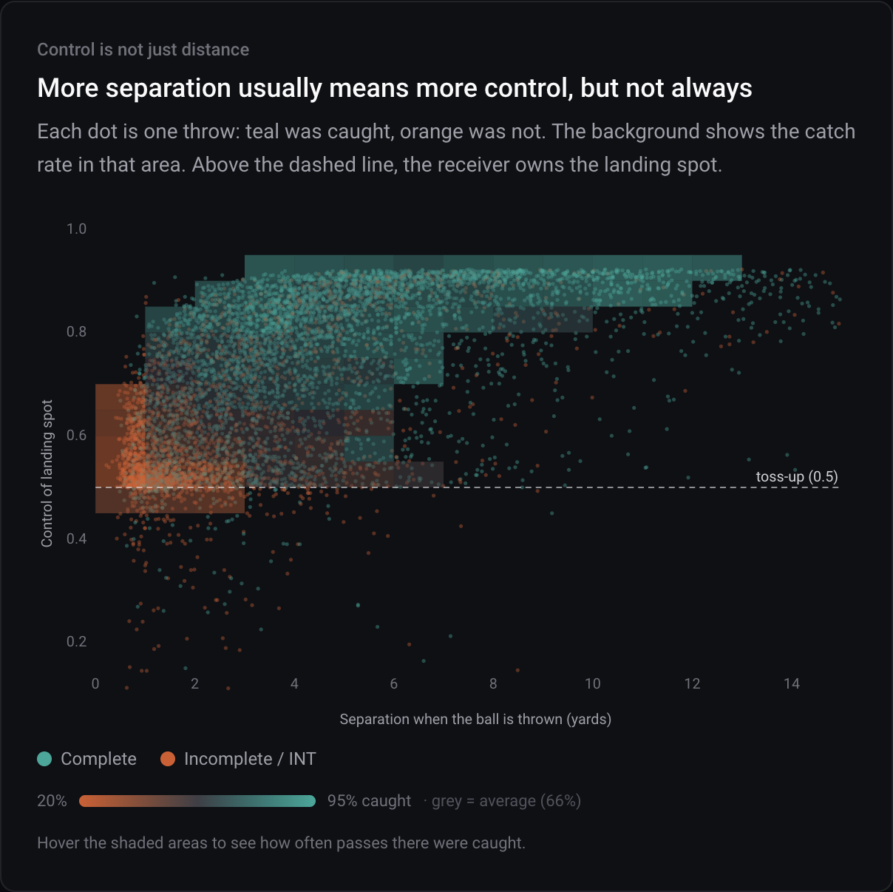

Each dot is one throw (teal = caught, orange = not caught). Above the dashed line, the receiver owns the landing spot.

- More separation usually means more control, but the spread is wide (correlation 0.56).
- Moving **up** at a fixed separation turns the background from orange to teal. That vertical change is what distance alone cannot see.

### 8. Catches are won in the second before the throw

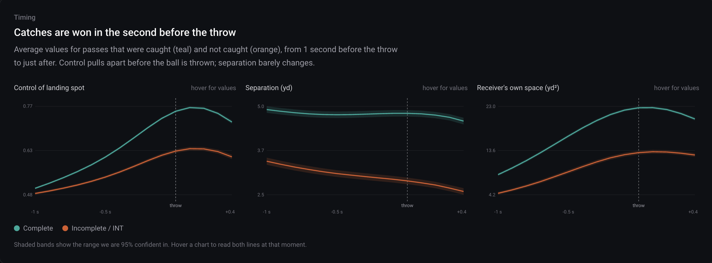

Averages for caught (teal) and not caught (orange) passes, from 1 second before the throw to 0.4 seconds after.

| | 1 s before the throw | At the throw |
|---|---|---|
| Control, caught | 0.50 | **0.75** |
| Control, not caught | 0.49 | **0.62** |
| Separation, caught | 4.9 yd | 4.8 yd |
| Separation, not caught | 3.4 yd | 2.9 yd |

Control starts even and pulls apart in the final second. Separation barely moves. The receiver wins the landing spot before the ball is out.

### 9. Ideas we tested

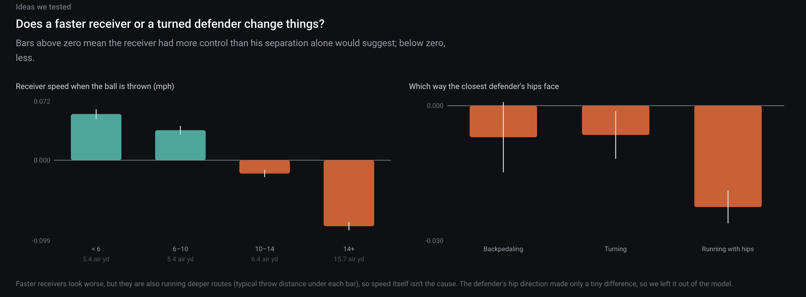

Bars above zero mean more control than separation alone would suggest.

- **Receiver speed:** the fastest receivers (14+ mph) look worse. But they also run much deeper routes (15.7 air yards against 5.4), so the route depth, not the speed, explains it.
- **Defender hips:** which way the closest defender faces made only a tiny difference, so we left it out.

---

## Conclusion

**Back to the question: the receiver's space helps, but only the space he has at the moment of the throw.**

1. **Space at the throw is what counts.** The most open receivers are caught 82% of the time against 48% for the least open. Space gained after the ball is out adds nothing (61% vs 65%).
2. **Distance is not the same as being open.** At the same 1 to 2 yards of separation, the receiver who owns the landing spot is caught twice as often (67% vs 34%). Two receivers who look equally open on a stat sheet are often not.
3. **The catch is decided before the throw.** Control of the landing spot separates catches from incompletions in the last second before release, while the distance to the defender barely changes.
4. **There is room to improve decisions.** Quarterbacks find the most open receiver on only 30% of throws, and those throws are caught 76% of the time against 53% for the 4th option or lower.

**What it means on the field**

- **Receivers:** win the landing spot before the ball is thrown. Getting there first matters more than adding a yard of distance late.
- **Quarterbacks and coaches:** "who owns the spot" is a better read than "who has the most distance". Plays that send the ball to the most open man are caught far more often.
- **Defenders:** being close is not enough. A defender who is beaten to the landing spot loses the play even at two yards.
- **Analysts:** separation is a strong single number (0.70), and our space measure is close (0.66). The value of a field-based view is that it explains *why* two equal separations end differently, and it ranks every option on the play.

**Limits.** Tracking stops half a second after the throw, so we measure the moment of release, not the catch. These are patterns, not proof of cause: route design, timing and coverage all play a part. We don't model the quarterback's reads or the pass rush. The data covers eight weeks of one season.

---

## How we measure it

- **Data.** NFL Next Gen Stats tracking (all 22 players and the ball, 10 frames per second), 2021 weeks 1 to 8, with Pro Football Focus roles. Completions, incompletions and interceptions only. Interceptions count as not caught.
- **The target.** Read from the play description ("pass short right to C.Lamb") and matched to a route runner.
- **Influence zone.** Each player is an ellipse placed half a second ahead of where he is running, stretched in the direction his body faces, longer and thinner as he speeds up.
- **Open space.** The area the receiver owns (his influence beats all 11 defenders) in a 30 × 30 yard window around where he will be half a second after the throw.
- **Separation.** Distance to the nearest defender at the throw.
- **Confidence.** Catch rates show 95% ranges. Prediction scores (AUC) compare one measure against the result on all 7,104 targets.

## The site

- **Film room.** Search any of 416 receivers and step through his targets. Autoplay moves to the next play.
- **3D replay.** A stadium built in code shows the quarterback, the target, the closest defender and the ball, with a live map of the receiver's space after the throw. Five camera views.
- **Charts.** Every chart is interactive, with a plain-language hint on how to read it.

## Run it

Needs Node.js 20.9 or newer.

```bash
cd frontend
npm install
npm run dev          # http://localhost:3000
```

To deploy on Vercel, import the repo, set **Root Directory** to `frontend`, and keep the Next.js preset. All the data the site needs is already in `frontend/public/data`.

To rebuild the data from the raw tracking files (about 12 minutes):

```bash
cd backend
uv venv .venv --python 3.12 && uv pip install --python .venv/bin/python -r requirements.txt
git clone --depth 1 https://github.com/ThompsonJamesBliss/nfl-big-data-bowl-regional-event-data ~/Downloads/NFL/bdb-regional
.venv/bin/python scripts/build_akit.py ~/Downloads/NFL/bdb-regional/data   # -> backend/data/*.parquet
.venv/bin/python scripts/export_static.py                                    # -> frontend/public/data/*.json
.venv/bin/python scripts/export_headshots.py                                 # -> headshots.json
# deep-dive charts -> control.json
git clone --depth 1 https://github.com/hard-hustler/NFL-PRE-WORK ~/Downloads/NFL/NFL-PRE-WORK
.venv/bin/python scripts/export_prework_charts.py ~/Downloads/NFL/NFL-PRE-WORK/data/derived
```

| Path | What it does |
|---|---|
| `backend/scripts/build_akit.py` | Finds the target, builds each influence zone, computes open space for every route runner |
| `backend/akit.py` | API and the summary numbers behind the charts |
| `backend/scripts/export_static.py` | Writes the data to static JSON for the site |
| `frontend/lib/akit.ts` | The influence math used in the browser |
| `frontend/components/` | The page, charts, filmstrip and 3D replay |
| `frontend/public/data/` | Pre-computed data the site reads |
| `assets/` | Screenshots used in this README |

## References

- Fernández, J. and Bornn, L. (2018). *Wide Open Spaces: A statistical technique for measuring space creation in professional soccer.* MIT Sloan Sports Analytics Conference.
- Spearman, W. (2018). *Beyond Expected Goals.* MIT Sloan Sports Analytics Conference.
- Fujimura, A. and Sugihara, K. (2005). Geometric analysis and quantitative evaluation of sport teamwork. *Systems and Computers in Japan*, 36(6), 49 to 58.
- Narizuka, T., Yamazaki, Y. and Takizawa, K. (2020). *Fundamental framework for the space evaluation in football games.* arXiv:2001.11629.

Data: NFL Next Gen Stats via the NFL Big Data Bowl, Pro Football Focus scouting data, nflverse rosters (headshots), and the ThompsonJamesBliss/nfl-big-data-bowl-regional-event-data repository.
