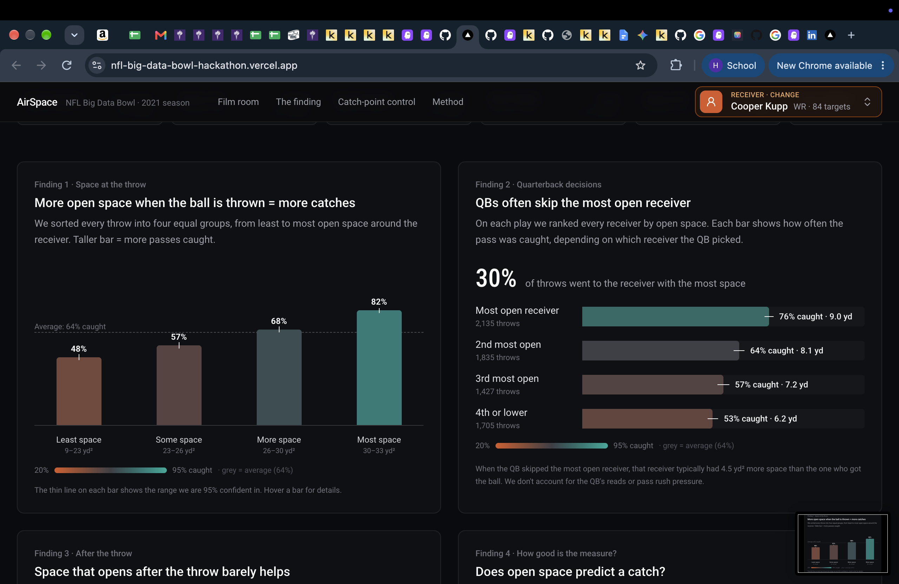

# AirSpace

**Live demo:** https://nfl-big-data-bowl-hackathon.vercel.app

## The question

> **When the quarterback lets go of the ball, does the receiver's space help or hurt?**

Tracking data usually describes "open" with one number: the distance to the nearest defender. We ask whether that is enough. Two receivers can be the same two yards from their defender and still be in very different positions, because one of them owns the spot where the ball will come down and the other does not.

## Abstract

We studied every pass thrown to a wide receiver, tight end or running back in 122 NFL games from the 2021 season (weeks 1 to 8): **7,104 targets**. We turn each of the 22 players into a moving, direction-aware field of influence. A receiver's **open space** is the area, in square yards, that he owns at the moment of the throw, measured against all 11 defenders.

What we found:

- **Open space at the throw predicts the catch.** Receivers in the most-open quarter are caught 82% of the time, against 48% in the least-open quarter.
- **Quarterbacks often skip the open man.** Only 30% of throws go to the receiver with the most space. Those throws are caught 76% of the time.
- **Space that opens after the throw does not help.** Where the receiver stands when the ball leaves the quarterback's hand is what counts.
- **Distance alone hides the story.** At the same separation, the receiver who controls the landing spot is caught up to twice as often (34% against 67% at 1 to 2 yards).
- **Catches are won before the throw.** Control of the landing spot pulls apart in the last second before release, while separation barely moves.

One honest limit: tracking stops half a second after the throw, so we measure the moment of release, not the catch itself. And plain separation is a slightly better single predictor of a catch than our open-space number (0.70 against 0.66). We explain why we keep both in [chapter 4](#4-is-open-space-a-good-measure).



*The AirSpace dashboard. Every chart below comes from this page. Teal means good for the offense, orange means good for the defense, and grey is the league average.*

---

## The story

### 1. More open space at the throw means more catches


**How to read it.** We sorted every throw into four equal groups, from least to most open space around the receiver. Each bar is the share of passes caught in that group. The dashed line is the average (64%). The thin line on each bar is the range we are 95% confident in.

**What it says.**
- The catch rate climbs with every step: 48%, 57%, 68%, 82%.
- The most open quarter (30 to 33 yd² of space) is caught **34 points** more often than the least open quarter (9 to 23 yd²).
- Open receivers also gain more yards: 5.3 yards per target in the least-open group, 9.4 in the most-open group.

### 2. Quarterbacks often skip the most open receiver


**How to read it.** On every play we ranked all the route runners by open space at the throw. Each bar shows how often the pass was caught depending on which of those receivers the quarterback picked.

**What it says.**
- Only **30%** of throws went to the most open receiver. Picking at random among the options would hit him 22% of the time.
- Throws to the most open receiver were caught **76%** of the time and gained 9.0 yards. Throws to the third most open receiver were caught 57% of the time, and throws to the fourth or lower 53%.
- When the quarterback passed on the open man, that receiver typically had **4.5 yd²** more space than the one who got the ball.

**Caution.** We do not model the quarterback's reads or the pass rush. A checkdown to a running back can be the right call, and running backs are the most open option about half of the time.

### 3. Space that opens after the throw barely helps


**How to read it.** We compared the space a receiver owned at the throw with the space he owned half a second later, the last moment the tracking data covers. We split throws into those where he lost space and those where he gained it.

**What it says.**
- Receivers who lost space were caught 65% of the time (4,308 throws). Receivers who gained space were caught 61% of the time (2,518 throws).
- Gaining space after the ball is out does not raise the catch rate. Compare this with chapter 1: space **at the throw** matters far more.
- A receiver who starts with a lot of space has little room to gain more, because the scale tops out near 33 yd².

### 4. Is open space a good measure?


**How to read it.** Each dot scores how well a measure tells catches from incompletions. 0.5 is a coin flip and 1.0 is always right. Further right is better.

**What it says.**
- Plain **separation** (distance to the closest defender) scores 0.70. Our **open space at the throw** scores 0.66. Open space half a second later scores 0.63.
- The **change in space** after the throw scores 0.48, no better than a coin flip. This confirms chapter 3.
- The two main measures mostly agree (rank correlation 0.73). Open space looks at where every defender is running and facing, not just the closest one.

**Why we keep open space anyway.** Separation is a little better as a single predictor, and we say so. Open space is the measure that lets us rank **every** receiver on the play at the throw, which is what makes chapter 2 possible. It also shows where the space is, which is what the 3D replay draws.

### 5. Who gets the space


**How to read it.** Average open space at the throw for each receiver with at least 15 targets (175 receivers). To keep small samples from topping the list, each average is pulled slightly toward the league average. Click a name on the site to watch his plays.

**What it says.**
- Running backs fill the top of the list: 17 of the top 20. Compare receivers within a position.
- The median receiver has 27 targets, so treat the list as "worth a look", not a final ranking.


**How to read it.** The same measure for the three position groups, with the catch rate for each.

**What it says.**
- Running backs get the most space (28.2 yd² at the throw) and are caught most often (76%).
- Tight ends (25.7 yd², 67%) and wide receivers (25.5 yd², 59%) get almost the same space but differ by 8 points in catch rate. Space is only part of the story.
- Between 32% and 37% of receivers gain space in the half second after the throw, in every group.

---

## Deep dive: separation is a distance, control is a field

Chapters 1 to 5 ask how much space a receiver owns. The deep dive asks a sharper question: **when the ball is thrown, who owns the spot where it will come down?**

We score this as **control of the landing spot**: 0.5 is a toss-up and 1.0 means the receiver owns it. Because tracking ends half a second after the throw, we estimate where the ball will land by projecting the ball's path and the receiver's path forward until they meet. We use the 6,790 targets where that projection is usable. As a check, 93% of throws the play-by-play labels "deep" land at 15 or more estimated air yards, and 95% of those labelled "short" land under 15.

### 6. Two receivers can be equally open and still have very different odds


**How to read it.** Each column is a range of separation. Inside each column we split the plays into three equal groups by how much the receiver controlled the landing spot: most, middle and least. Each cell is the catch rate for that group, and the line chart on the right shows the same numbers.

**What it says.**
- At **1 to 2 yards** of separation, the catch rate is **34%** for the least-control group and **67%** for the most-control group: twice the catches at the same distance.
- The gap is wide where the defender is close enough to matter but not on top of the receiver: 2 to 3 yards is 42% against 78%, and 3 to 4 yards is 58% against 86%.
- At 0 to 1 yards almost everything fails (17% to 27%), and at 10 or more yards almost everything succeeds (86% to 93%). Control cannot rescue a receiver who is smothered, and it does not matter once he is wide open.

### 7. Control is related to distance, but it is not the same thing


**How to read it.** Each dot is one throw. Teal was caught and orange was not. The horizontal axis is separation, the vertical axis is control of the landing spot, and the dashed line is the toss-up level (0.5). The shaded background is the catch rate in that area.

**What it says.**
- More separation usually means more control (correlation 0.56), but there is a lot of spread. At the same separation, receivers sit anywhere from toss-up to full control.
- Moving up at a fixed separation turns the background from orange to teal. That vertical change is the part distance cannot see.
- The orange cluster in the lower left is receivers who were tight to their defender and had only a toss-up at the landing spot. They were mostly not caught.

### 8. Catches are won in the second before the throw


**How to read it.** Average values for passes that were caught (teal) and not caught (orange), from one second before the throw to 0.4 seconds after. The three panels show control of the landing spot, separation, and the receiver's own space. Shaded bands are 95% ranges.

**What it says.**
- **Control** starts in the same place one second before the throw (about 0.5 for both groups). By the moment of the throw it is **0.75 on caught passes and 0.62 on uncaught passes**.
- **Separation** is already different a second earlier (about 4.9 yards on caught passes against 3.4 on uncaught ones) and stays roughly flat, drifting down by half a yard on uncaught passes. The gap does not open up in this window.
- The receiver's **own space** grows from about 8.5 to 23 yd² on caught passes, but only from about 4.5 to 13 yd² on uncaught passes.
- Together: the catch is decided by how the receiver and his defender are positioned relative to the landing spot as the quarterback releases, not by a distance that changes at the last moment.

### 9. Ideas we tested and what we did with them


**How to read it.** Bars above zero mean the receiver had more control than his separation alone would suggest. Bars below zero mean less.

**What it says.**
- **Speed:** the fastest receivers (14+ mph) look worse than their separation suggests. But they are also running much deeper routes (a typical 15.7 air yards, against 5.4 for receivers under 6 mph), so speed itself is not the cause.
- **Defender hips:** which way the closest defender's hips face made only a tiny difference, so we left it out of the control measure.

---

## How we measure it

- **Data.** NFL Next Gen Stats tracking (all 22 players and the ball, 10 times a second) from the Big Data Bowl regional event data, 2021 weeks 1 to 8, plus Pro Football Focus roles to tell route runners from blockers. We keep dropbacks that ended in a catch, incompletion or interception (sacks and scrambles are out). An interception counts as not caught.
- **The target.** The data does not say who the pass was for, so we read it from the play description ("pass short right to C.Lamb") and match it to a route runner. Ambiguous matches are dropped.
- **Influence field.** Each player is a smooth ellipse of influence. It is centered half a second ahead along his velocity, stretched along the way his body is facing, and it gets longer and thinner as he speeds up.
- **Open space.** The area, in yd², that the receiver owns in a 30 by 30 yard window around where he will be half a second after the throw. A spot is his if his influence beats all 11 defenders. We score every route runner on the play, not only the target.
- **Separation.** The distance to the nearest of the 11 defenders at the throw.
- **Intervals and validation.** Catch rates carry 95% intervals. Each predictive score (AUC) compares one measure against the outcome on all 7,104 targets. No model is fit, so there is no train and test split to worry about.

## The site


- **Film room.** Search any of 416 receivers (with a position filter) and step through his targets on a filmstrip. Autoplay moves to the next play one second after one ends.
- **3D replay.** A stadium built in code shows the quarterback, the target, the closest defender and the ball, with a live map of the cells the receiver owns after the throw. Five cameras: Broadcast, Overhead, All-22, Follow and Free orbit. Ball height is illustrative because tracking is two-dimensional.
- **Charts.** Every chart on this page is live, animated, and shows details on hover. Each carries a one-line hint on how to read it.

## What to keep in mind

1. Tracking ends half a second after the throw. We study the moment of release, not the catch.
2. These are associations, not proof of cause. Route design, quarterback timing and coverage all feed the numbers.
3. We do not model the quarterback's reads or the pass rush.
4. Open space tops out near 33 yd², so it separates crowded receivers from open ones better than open from very open.
5. Eight weeks of one season: the intervals describe noise within these 122 games.

## Run it

Needs Node.js 20.9 or newer.

```bash
cd frontend
npm install
npm run dev          # http://localhost:3000
```

To deploy on Vercel, import the repo, set **Root Directory** to `frontend`, and keep the Next.js preset. No environment variables are needed. All the data the site reads is already in `frontend/public/data`.

To rebuild the play data from the raw tracking files (about 12 minutes):

```bash
cd backend
uv venv .venv --python 3.12 && uv pip install --python .venv/bin/python -r requirements.txt
git clone --depth 1 https://github.com/ThompsonJamesBliss/nfl-big-data-bowl-regional-event-data ~/Downloads/NFL/bdb-regional
.venv/bin/python scripts/build_akit.py ~/Downloads/NFL/bdb-regional/data   # about 6 min -> backend/data/*.parquet
.venv/bin/python scripts/export_static.py                                    # about 6 min -> frontend/public/data/*.json
.venv/bin/python scripts/export_headshots.py                                 # player headshots -> headshots.json
# catch-point control charts (deep dive) from the pre-work repo -> control.json
git clone --depth 1 https://github.com/hard-hustler/NFL-PRE-WORK ~/Downloads/NFL/NFL-PRE-WORK
.venv/bin/python scripts/export_prework_charts.py ~/Downloads/NFL/NFL-PRE-WORK/data/derived
```

`backend/main.py` also serves the same data as an API (`.venv/bin/uvicorn main:app --port 8000`).

### Where things are

| Path | What it does |
|---|---|
| `backend/scripts/build_akit.py` | Finds the target, builds each influence field, computes open space for every route runner |
| `backend/akit.py` | API and summary statistics behind the charts |
| `backend/scripts/export_static.py` | Writes the API responses to static JSON for the site |
| `frontend/lib/akit.ts` | The influence-field math used in the browser (same as the backend) |
| `frontend/components/akit/` | The page, the charts, the filmstrip and the receiver picker |
| `frontend/components/replay/` | The 3D stadium, players and space map |
| `frontend/public/data/` | Pre-computed data the site reads |

## References

- Fernández, J. and Bornn, L. (2018). *Wide Open Spaces: A statistical technique for measuring space creation in professional soccer.* MIT Sloan Sports Analytics Conference.
- Spearman, W. (2018). *Beyond Expected Goals.* MIT Sloan Sports Analytics Conference.
- Fujimura, A. and Sugihara, K. (2005). Geometric analysis and quantitative evaluation of sport teamwork. *Systems and Computers in Japan*, 36(6), 49 to 58.
- Narizuka, T., Yamazaki, Y. and Takizawa, K. (2020). *Fundamental framework for the space evaluation in football games.* arXiv:2001.11629.

Tracking data: NFL Next Gen Stats via the NFL Big Data Bowl. Scouting data: Pro Football Focus. Headshots: nflverse rosters. Regional event data: ThompsonJamesBliss/nfl-big-data-bowl-regional-event-data.
